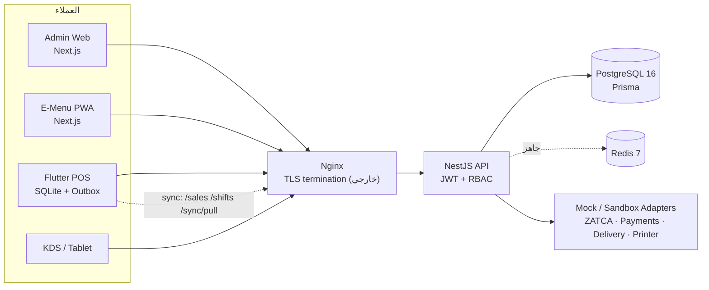
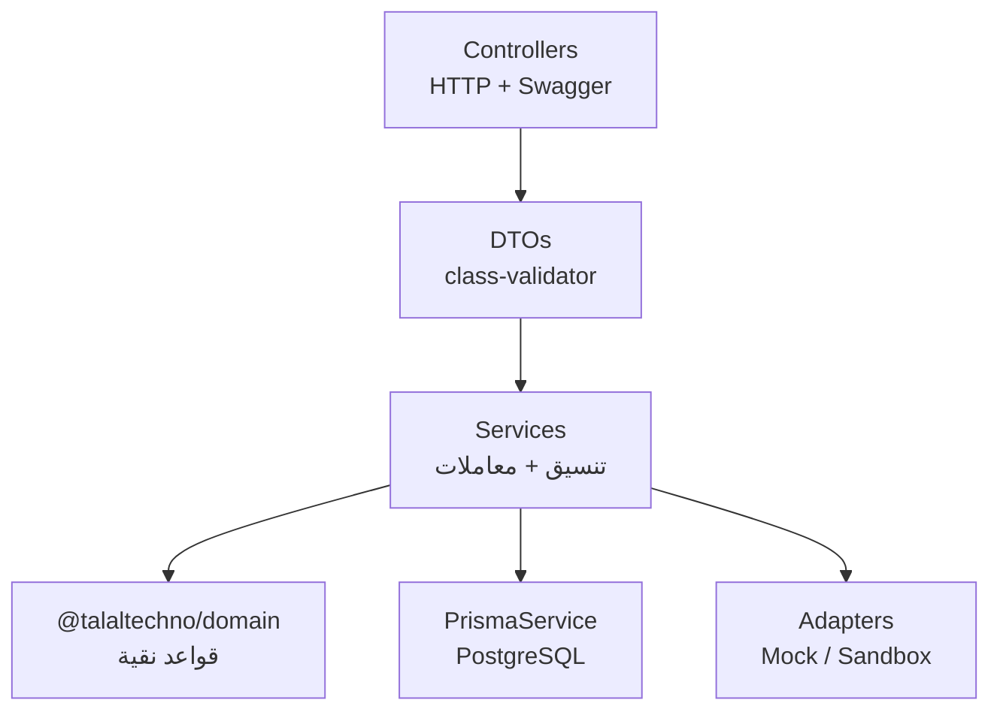
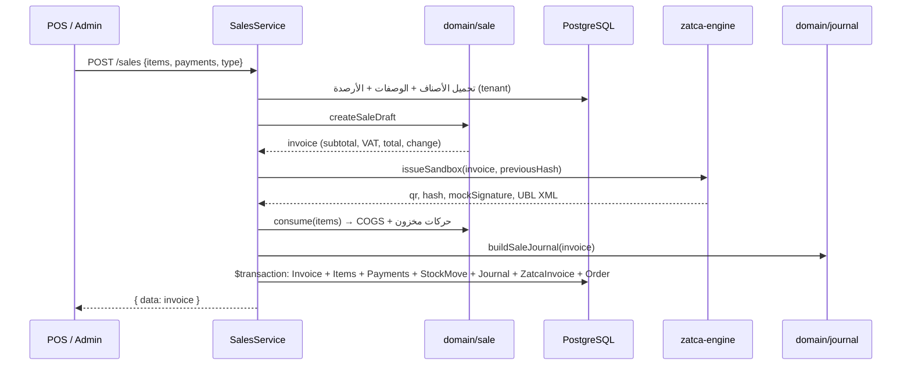
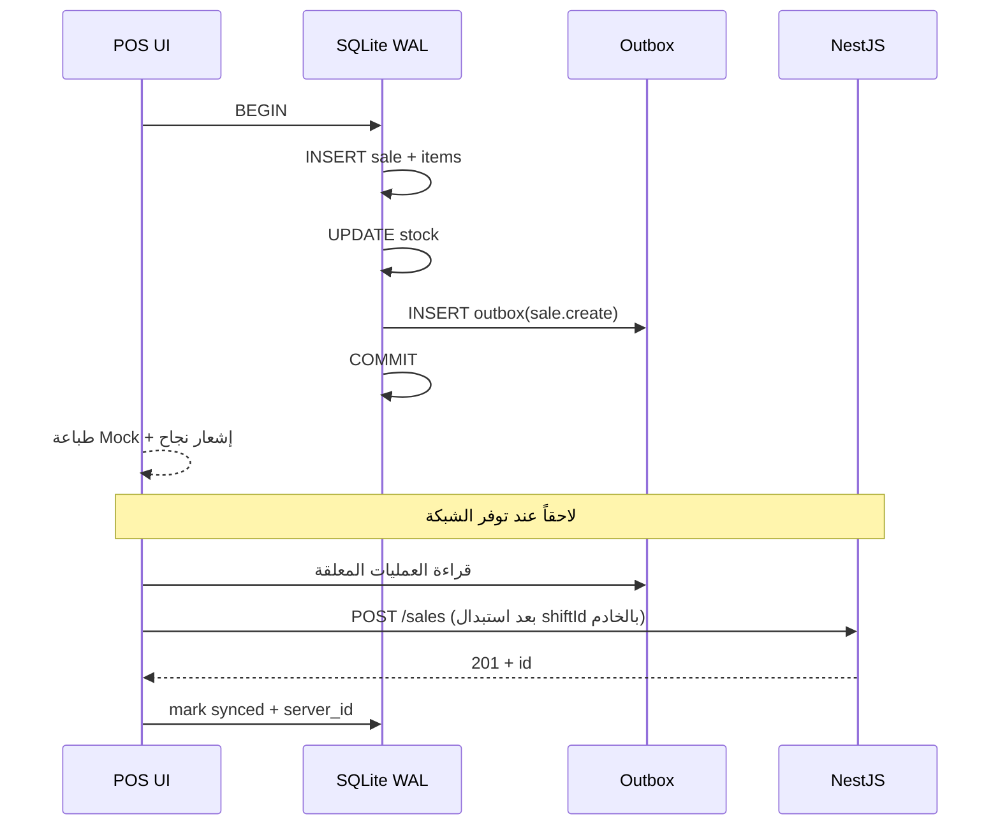
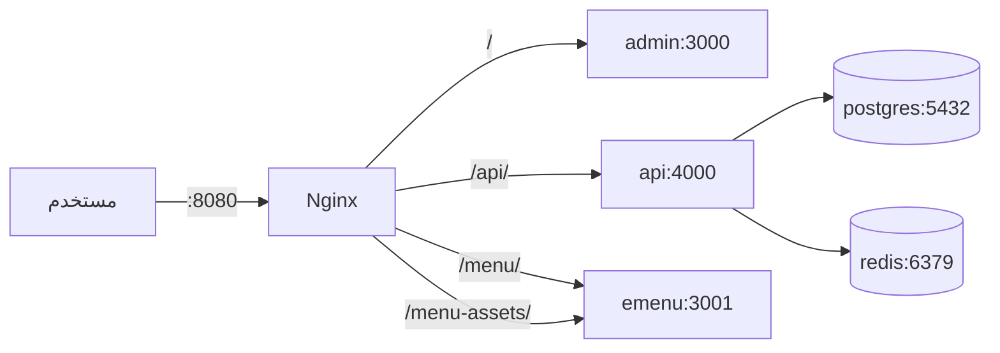

# المعمارية — طلال تكنو

> آخر تحديث: 2026-10-27 · الإصدار 1.0.0 · الرخصة AGPL-3.0-or-later

## 1. الأهداف والنطاق

**الهدف:** نظام ERP + POS سعودي لمطاعم ومقاهي، عربي أولاً (RTL)، يعمل بكفاءة على أجهزة لمس، ويستمر البيع فيه عند انقطاع الإنترنت، مع محاسبة مزدوجة وتكاملات جاهزة لبيئة Sandbox.

**داخل النطاق:**

- نقاط بيع متعددة الفروع والأجهزة، ورديات، طاولات، طلبات، مطبخ.
- مخزون مواد خام + وصفات BOM + هالك/تحويلات/تسويات.
- محاسبة مزدوجة وتقارير مالية.
- ZATCA المرحلة الثانية **Sandbox** (UBL 2.1، QR TLV، سلسلة تجزئة، توقيع وهمي موسوم).
- تكاملات مدفوعات وتوصيل بنمط Adapter + Mock + Sandbox.
- قائمة QR/PWA، ولاء وكوبونات، مشتريات، تقارير.
- تطبيق POS Flutter يعمل Offline-First مع SQLite WAL وصندوق صادر.

**خارج النطاق (حالياً):**

- شهادة ZATCA/SAMA الفعلية أو إرسال فواتير حقيقية.
- تحصيل أموال حقيقي أو ربط مباشر مع بنوك/PSP.
- محاسبة رواتب كاملة، إقرارات ضريبية رسمية، فوترة إلكترونية معتمدة.
- تطبيقات iOS/Android موقّعة ومُنشورة.
- تعدد العملات الفعلي (العملة الأساسية SAR).

## 2. سياق النظام



**ملاحظات:**

- Redis موجود في المنصة لكن BullMQ/الطوابير غير مُفعّلة بعد؛ كل العمليات متزامنة داخل API.
- كل تكامل خارجي يمر عبر واجهة محوّلة (Adapter) ولا يستدعي مزوداً حقيقياً في الوضع الافتراضي.
- لا يوجد اتصال مباشر من POS إلى PostgreSQL؛ المزامنة عبر REST فقط.

## 3. بنية المستودع

```
apps/
  api/       NestJS — طبقة التطبيق والتحقق والتنسيق
  admin/     Next.js App Router — واجهة إدارية RTL
  emenu/     Next.js PWA — قائمة عامة للزبون
  pos/       Flutter — عميل Offline-First
packages/
  domain/    منطق أعمال نقي (JS، بلا اعتماديات)
  database/  Prisma schema + seed
  shared-types/  عقود TypeScript
  zatca-engine/  واجهة Sandbox
  thermal-printer/ ESC/POS + Mock
```

### قواعد الاعتماد

```
apps/*  ──►  packages/domain, database, shared-types, zatca-engine, thermal-printer
packages/zatca-engine, thermal-printer ──► packages/domain (اختياري)
packages/domain ──► لا شيء (Node built-ins فقط)
```

- لا تستورد `packages/domain` أي حزمة خارجية ولا `apps/*`.
- لا تعرف `packages/database` شيئاً عن HTTP.
- `apps/api` هو المكان الوحيد الذي ينسّق Prisma + Domain + Adapters.
- المتصفح التجريبي يكرر القواعد نفسها في `assets/js/core/` لأنه لا يمر بخط بناء؛ اختبارات `packages/domain` هي المرجع.

## 4. طبقات API



- **Guards عامة:** `JwtAuthGuard` يتحقق من Bearer، و`RolesGuard` يقرأ `@Roles(...)` و`@Public()`.
- **التحقق:** `ValidationPipe` عام مع `whitelist` و`forbidNonWhitelisted` و`transform`.
- **الأخطاء:** `HttpExceptionFilter` يعيد شكلاً موحداً برسائل عربية وأكواد إنجليزية.
- **المعاملات:** العمليات المالية (بيع/مرتجع/وردية/استلام شراء) تُنفّذ داخل `prisma.$transaction`.
- **العزل:** كل استعلام أعمال يحمل `tenantId` من JWT، ولا يُقبل من العميل.

### الأدوار والصلاحيات

| الدور | نطاق نموذجي |
|---|---|
| `OWNER` / `ADMIN` | كل شيء |
| `MANAGER` | كتالوج، طلبات، مبيعات، ورديات، مخزون، ولاء، تكاملات، قراءة محاسبة |
| `CASHIER` | إنشاء وقراءة مبيعات، فتح/إغلاق وردية، طلبات |
| `WAITER` | طاولات وطلبات |
| `KITCHEN` | قراءة الطلبات وتغيير حالتها |
| `ACCOUNTANT` | محاسبة، تقارير، مشتريات، ZATCA، قراءة مبيعات |
| `DELIVERY_MANAGER` | طلبات توصيل وحالاتها |

الصلاحيات مُشتقة من الدور في `auth.service.ts` وتُضمّن في JWT؛ ويمكن لاحقاً استبدالها بجدول صلاحيات دقيق دون تغيير الواجهات.

## 5. نموذج البيانات

المخطط الكامل في [docs/ERD.md](docs/ERD.md). المبادئ:

1. **Multi-tenant:** كل جدول أعمال يحمل `tenantId` (مباشرة أو عبر علاقة أب). لا توجد جداول مشتركة بين المستأجرين عدا `Tenant` نفسه.
2. **المال:** `Decimal(12,2)` بالريال، وتقريب هللات في طبقة Domain عبر `round2`.
3. **المواد الخام مقابل الأصناف:**
   - `Product.type = RAW` + `StockLevel` = مادة خام.
   - `Product.type = MENU` + `RecipeLine[]` = صنف قائمة؛ توفره يُحسب من أرصدة مكوناته.
4. **الطلبات والفواتير منفصلة:** `Order` يمثل دورة المطبخ، و`Invoice` يمثل الأثر المالي والضريبي. يمكن لطلب أن يتحول لفاتورة واحدة أو عدة فواتير (Split).
5. **ZATCA منفصلة:** `ZatcaInvoice` يحمل `uuid`، `invoiceHash`، `previousHash`، `qr`، `status`، `signedXml` — مستقل عن `Invoice` ليمكن إعادة الإرسال أو التصحيح.
6. **التدقيق:** `AuditLog` لكل تغيير حساس، و`SyncOperation` لتتبع عمليات الأجهزة.

## 6. تدفق البيع (Online)



**نقاط حاسمة:**

- السعر يُؤخذ من الخادم افتراضياً، ولا يُقبل سعر عميل إلا بصلاحية صريحة (حالياً DTO يسمح بـ`price` للتجربة).
- الدفع الزائد يُعاد كـ`change`؛ الدفع الآجل يتطلب عميلاً.
- رسوم الخدمة/التوصيل تُقيّد إلى `4102` ولا تدخل في وعاء الضريبة إلا إذا كانت خاضعة بحسب الإعداد (النسخة الحالية تضعها خارج `subtotal` الخاضع).
- ترقيم الفواتير يُشتق من أعلى تسلسل موجود داخل المستأجر (وليس count) لتجنّب التكرار بعد الحذف.
- السلسلة الضريبية: `previousHash` = آخر `invoiceHash` للمستأجر.

## 7. المرتجعات

- `POST /sales/:id/returns` يتحقق من الكميات المرتجعة تراكمياً (لا يتجاوز الأصل).
- يُنشئ `Invoice.type = RETURN`، ويعكس المخزون وCOGS والضريبة.
- يعكس نقاط الولاء بمقدار لا يتجاوز ما كسبه العميل من الفاتورة الأصلية.
- يقبل طرق استرداد متعددة؛ القيد يوزّع الدائن على حسابات الطرق.

## 8. Offline-First في Flutter POS



**الضمانات:**

- البيع + البنود + خصم المخزون + صف الصندوق في **معاملة SQLite واحدة**. لا يمكن فقدان بيع محفوظ.
- `PRAGMA journal_mode=WAL` يسمح بالقراءة أثناء الكتابة.
- ترتيب الرفع: `shift.open` ← `sale.create` ← `shift.close` (اعتماد تسلسلي).
- كل عملية فاشلة تزيد `attempts` وتحفظ `last_error` وتبقى في الصندوق.
- إعادة المحاولة آمنة نظرياً، لكن **لا يوجد مفتاح Idempotency على الخادم بعد**؛ قد يتكرر البيع إذا نجح الخادم وفشل الرد. هذه فجوة معروفة موثقة في ROADMAP.
- `GET /sync/pull` يعيد مرجع المنتجات والفروع؛ التطبيق يحدّث منتجات القائمة فقط ويحتفظ ببيانات البيع المحلية.

## 9. المحاسبة المزدوجة

### دليل الحسابات الموحّد

| الرمز | الحساب | النوع |
|---|---|---|
| `1101` | الصندوق (النقدية) | أصل |
| `1102` | البنك / الشبكة | أصل |
| `1103` | المدينون (العملاء) | أصل |
| `1104` | المخزون | أصل |
| `1105` | ضريبة القيمة المضافة — مدخلات | أصل |
| `2101` | الدائنون (الموردون) | التزام |
| `2102` | ضريبة القيمة المضافة — مخرجات | التزام |
| `4101` | إيرادات المبيعات | إيراد |
| `4102` | إيرادات أخرى (خدمة/توصيل) | إيراد |
| `4103` | مرتجعات المبيعات | مقابل إيراد |
| `4104` | خصم على المبيعات | مقابل إيراد |
| `5101` | تكلفة البضاعة المباعة | مصروف |
| `5108` | فاقد المخزون | مصروف |

### قيد البيع النموذجي

| الحساب | مدين | دائن |
|---|---|---|
| الصندوق/البنك/المدينون | الإجمالي المحصّل + الآجل | — |
| خصم المبيعات | الخصم | — |
| إيرادات المبيعات | — | صافي البنود |
| إيرادات أخرى | — | رسوم الخدمة/التوصيل |
| ضريبة المخرجات | — | الضريبة |
| تكلفة البضاعة المباعة | COGS | — |
| المخزون | — | COGS |

كل قيد يُفحص بـ`assertBalanced`، وتُختبر موازنة ميزان المراجعة في `packages/domain/test/journal.test.js`.

### المرتجع

عكس القيد: مدين `4103` + مدين `2102` (عكس ضريبة) + مدين `1104` (استرجاع مخزون) / دائن `5101` (عكس COGS) + دائن حساب الاسترداد.

## 10. ZATCA Sandbox

### ما يُنفّذ فعلاً

- **QR TLV:** الحقول 1–5 (اسم البائع، الرقم الضريبي، الطابع الزمني، الإجمالي، الضريبة) بترميز Base64.
- **UBL 2.1:** XML يحتوي `ProfileID`, `ID`, `UUID`, `IssueDate/Time`, `InvoiceTypeCode` (388 بيع / 381 مرتجع)، `AccountingSupplierParty`, `AccountingCustomerParty`, `TaxTotal`, `LegalMonetaryTotal`, `InvoiceLine`, ومرجع QR وPIH.
- **سلسلة التجزئة:** `SHA-256` على سلسلة حقول منظمة، و`previousHash` يربط كل فاتورة بسابقتها.
- **التوقيع:** `mockSignature` = Base64 لـ`MOCK-ECDSA-SECP256K1:<sha256>` — **ليس توقيعاً ECDSA صالحاً** وموسوم بوضوح.
- **التحقق:** `GET /zatca/chain/verify` يعيد عدد الفواتير المفحوصة والمكسورة والمعدّلة.

### ما لا يُنفّذ

- توليد CSID أو توقيع بـ`secp256k1` حقيقي.
- إرسال `Clearance` أو `Reporting` إلى بوابة ZATCA.
- ختم XML بـ`XAdES` أو إرفاق الشهادة.
- التعامل مع الفواتير المبسطة/القياسية بحسب قواعد الاعتماد الرسمية بالكامل.

كل استجابة ZATCA تحمل `environment: "sandbox"` و`warning` عربياً. لا يجوز استخدام المخرجات كفاتورة ضريبية.

## 11. نمط المحوّلات (Adapters)

```ts
interface PaymentAdapter {
  readonly name: string;
  readonly mode: 'mock' | 'sandbox';
  charge(input: ChargeInput): Promise<ChargeResult>;
}
```

- `MockPaymentAdapter` و`SandboxPaymentAdapter` (HyperPay/Geidea/Moyasar/PayTabs) في `apps/api/src/integrations/adapters/`.
- `MockDeliveryAdapter` و`SandboxDeliveryAdapter` (HungerStation/Jahez/Mrsool/ToYou/Careem).
- `MockPrinterAdapter` يبني ESC/POS ويعيد عدد البايتات دون اتصال.
- الاختيار من `PAYMENTS_MODE` / `DELIVERY_MODE` / `PRINTER_MODE`، والافتراضي `mock`.
- Sandbox بدون مفاتيح يفشل برسالة عربية واضحة ولا يسقط الخدمة.
- كل استجابة تحمل `mode` و`provider` و`reference` تجريبياً.

## 12. الواجهات

### Admin (Next.js)

- App Router + route group `(dashboard)`.
- RTL كامل، خط Tajawal مع بدائل نظامية، وضع داكن.
- مكوّنات UI مبنية يدوياً (Button, Card, Badge, Table, Dialog, Segmented, Switch, Progress) بأيقونات SVG مضمّنة.
- عند غياب `talaltechno_token` أو فشل API، تعمل الصفحات على **بيانات عرض** من `lib/demo.ts` مع شارة «وضع العرض». هذا يسمح بتقييم الواجهة دون قاعدة بيانات.
- لا مفاتيح في المتصفح؛ `NEXT_PUBLIC_API_URL` فقط.

### E-Menu PWA

- Next.js 15، `basePath: /menu` في الإنتاج، `assetPrefix: /menu-assets`.
- تقرأ `?table=<qrToken>&branch=<code>` من `window.location.search`.
- سلة في `sessionStorage` (`tt_emenu_cart`).
- Service Worker: network-first للتنقل، cache-first للأصول، **لا يخزّن API**.
- وضع عرض محلي عند تعذر API، مع وسم واضح.
- الطلب الذاتي يتطلب `settings.emenu.allowSelfOrder`، والطاولة إلزامية عند `requireTable`.

### Demo (Vanilla)

- 19 مسار hash، لا خط بناء، `localStorage`.
- طبقات: `core/db.js` (بيانات + حفظ)، `core/accounting.js`، `core/business.js`، `restaurant.js`، `zatca.js`، `integrations.js`، `pages/*`.
- يكرر قواعد Domain لأغراض العرض، ويُستخدم لاختبار التدفق الكامل في المتصفح.
- PWA + QR عبر `qrcode-generator` محلي (بلا CDN).

## 13. النشر



- Nginx يزيل بادئة `/api/` قبل التمرير، ويحافظ على `/menu` لأن Next basePath.
- API وAdmin لا يُنشران مباشرة؛ فقط Nginx على `HTTP_PORT`.
- E-Menu منشور أيضاً على `3001` للتصحيح.
- Health: `/health` (API)، و`/api/docs` (Swagger).
- الأسرار عبر `.env` فقط، و`.dockerignore` يستثني `.env*` عدا المثال.

## 14. الأمان والخصوصية

- JWT قصير العمر (`8h` افتراضياً) + `JWT_SECRET` إلزامي في الإنتاج.
- كلمات المرور `bcryptjs` بعشرة rounds.
- Helmet + CORS مقيد بـ`APP_URL`.
- التحقق من كل DTO، ورفض الحقول غير المعروفة.
- عزل المستأجر في كل استعلام.
- سجل تدقيق لأحداث الدخول والتغييرات الحساسة.
- لا تُخزَّن بيانات بطاقات؛ الدفع عبر PSP فقط (وحالياً Mock).
- النسخ الاحتياطي: ملفات مشفرة (مخطط) + `Backup` model.
- راجع [docs/SECURITY.md](docs/SECURITY.md) لنموذج التهديد الكامل.

## 15. القيود المعروفة

1. **لا شهادة ZATCA/SAMA** ولا تكامل إنتاجي حقيقي.
2. **Docker Compose لم يُشغَّل** في بيئة التسليم (Docker غير متوفر).
3. **API/Admin/E-Menu لم تُبنَ** لعدم توفر pnpm/PostgreSQL/Redis وقت التسليم.
4. **Flutter POS لم يُجمَّع** لعدم توفر Flutter/Android SDK.
5. **لا Idempotency** على `POST /sales` للمزامنة.
6. **Redis/BullMQ غير مستخدم**؛ لا طوابير خلفية أو Webhooks موقوتة.
7. **الطباعة حقيقية غير مدعومة**؛ Mock فقط.
8. **تعدد العملات** غير مطبق فعلياً.
9. **العرض التجريبي وAPI نسختان** من القواعد؛ قد ينحرفان مع التطوير.
10. **النسخ الاحتياطي التلقائي** غير مجدول.

هذه القيود مقصودة وموثقة؛ لا ينبغي قراءة هذا المستودع كمنتج معتمد جاهز للإنتاج دون استكمال ROADMAP.
