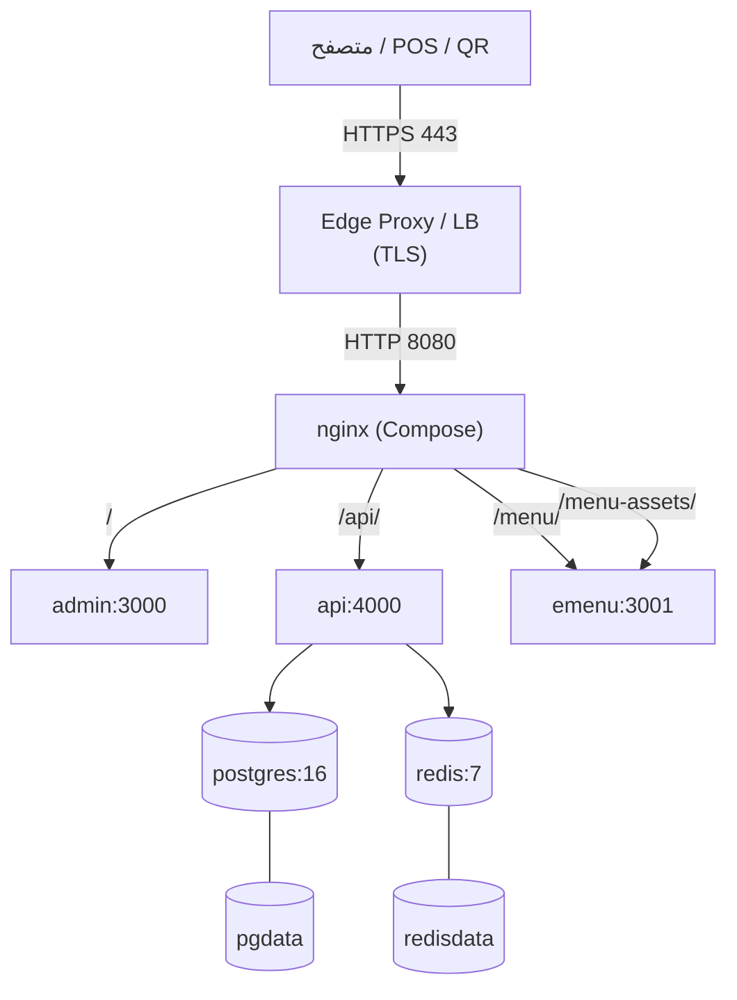

# دليل النشر — طلال تكنو

> **حالة التحقق:** لم يُنفَّذ `docker compose up` في بيئة التسليم (Docker غير متوفر). الخطوات أدناه مبنية على ملفات المشروع ويجب اختبارها في P4 قبل الإنتاج.

## 1. الطوبولوجيا



- **Nginx** هو نقطة الدخول الوحيدة داخل Compose.
- **Edge Proxy** (Caddy/Traefik/Cloudflare/Nginx خارجي) ينهي TLS. لا تنشر 8080 مباشرة للإنترنت.
- API/Admin/E-Menu غير منشورة على منافذ مضيف (عدا E-Menu 3001 للتصحيح؛ أغلقها في الإنتاج).

## 2. المتطلبات

| المتطلب | الحد الأدنى | الموصى به |
|---|---|---|
| Docker Engine | 24+ | 27+ |
| Docker Compose | v2.20+ | v2.30+ |
| CPU | 2 vCPU | 4 vCPU |
| RAM | 4 GB | 8 GB |
| Disk | 20 GB SSD | 100 GB SSD + نسخ خارجية |
| نظام | Linux x86_64 | Ubuntu 22.04/24.04 LTS |
| Node (خارج Docker) | 22 | 22 LTS |
| pnpm | 9.15.4 | 9.15.4 |

> Flutter/Android SDK مطلوبة فقط لبناء تطبيق POS، وليست للنشر السحابي.

## 3. متغيرات البيئة

```bash
cp .env.example .env
```

### إلزامية للإنتاج

| المتغير | ملاحظة |
|---|---|
| `POSTGRES_PASSWORD` | كلمة مرور قوية، ليست الافتراضية |
| `JWT_SECRET` | 48 بايت عشوائي على الأقل (`openssl rand -base64 48`) |
| `PIN_PEPPER` | قيمة عشوائية منفصلة |
| `APP_URL` | أصل الواجهة (CORS)، مثال `https://erp.example.sa` |
| `NEXT_PUBLIC_API_URL` | عنوان API من المتصفح، مثال `https://erp.example.sa/api` |
| `NODE_ENV` | `production` |
| `SEED_DEMO` | `false` في الإنتاج |
| `RUN_DB_PUSH` | `false` بعد تثبيت الترحيلات |

### اختيارية حسب التكامل

| المتغير | الافتراضي | ملاحظة |
|---|---|---|
| `PAYMENTS_MODE` | `mock` | `sandbox` يتطلب مفاتيح مزود |
| `DELIVERY_MODE` | `mock` | `sandbox` يتطلب مفاتيح |
| `PRINTER_MODE` | `mock` | `mock` لا يطبع |
| `ZATCA_ENVIRONMENT` | `sandbox` | لا تضع `production` بدون اعتماد |
| `HTTP_PORT` | `8080` | منفذ Nginx على المضيف |
| `EMENU_PORT` | `3001` | للتصحيح؛ أغلقها/احذفها في الإنتاج |
| `RUN_DB_PUSH` | `true` | اجعله `false` بعد ترحيلات |
| `SEED_DEMO` | `false` | `true` يزرع بيانات هدّامة |

**قواعد الأسرار:**

- لا تضع مفاتيح في `docker-compose.yml` أو Git.
- استخدم Secrets Manager أو ملف `.env` بصلاحية `600` ومالك مخصص.
- دوّر `JWT_SECRET` عند الاشتباه بتسريب (يُبطل كل الجلسات).
- `NEXT_PUBLIC_*` تظهر في حزمة المتصفح — لا تضع فيها أسراراً أبداً.

## 4. أول نشر

### أ) بناء وتشغيل

```bash
git clone <repo> talaltechno
cd talaltechno
cp .env.example .env
# حرّر .env: كلمات مرور، JWT_SECRET، APP_URL، NEXT_PUBLIC_API_URL

docker compose build
docker compose up -d
docker compose ps
docker compose logs -f api
```

> **ملاحظة بناء Next.js:** إخراج `standalone` مُفعَّل فقط عند `NEXT_STANDALONE=true`، وDockerfiles تضبطه تلقائياً. على Windows دون Developer Mode يفشل إنشاء symlinks، لذا يُبنى المشروع محلياً بدون standalone؛ للإنتاج المحلي شغّل `NEXT_STANDALONE=true pnpm build` مع تمكين symlinks.

انتظر `status: ok` من:

```bash
curl -fsS http://localhost:8080/health
```

### ب) المخطط والبيانات

الـAPI entrypoint ينفّذ `prisma db push` عند `RUN_DB_PUSH=true` (الافتراضي). للزرع:

```bash
docker compose exec api pnpm db:seed
```

أو مرة واحدة عند الإنشاء:

```bash
SEED_DEMO=true docker compose up -d api
# ثم أعده false في .env وأعد التشغيل
```

**تحذير:** السكربت يحذف كل بيانات الـTenant (`TRUNCATE ... CASCADE`) ويرفض العمل عند `NODE_ENV=production`. لا تشغّله على قاعدة حقيقية.

بيانات الدخول: `admin@talaltechno.dev` / `Talal@1234` — غيّرها فوراً.

### ج) الوصول

| الخدمة | الرابط |
|---|---|
| Admin | `http://localhost:8080` |
| API | `http://localhost:8080/api` |
| Swagger | `http://localhost:8080/api/docs` |
| E-Menu | `http://localhost:8080/menu/` |
| Health | `http://localhost:8080/health` |

### د) التحقق الأولي

```bash
# دخول
curl -s -X POST http://localhost:8080/api/auth/login \
  -H 'Content-Type: application/json' \
  -d '{"email":"admin@talaltechno.dev","password":"Talal@1234"}'

# قائمة عامة
curl -s 'http://localhost:8080/api/public/menu?branch=RUH'

# تحقق سلسلة ZATCA (يتطلب توكن)
```

## 5. الترحيلات (Migrations)

الوضع الحالي يستخدم `db push` لأن مجلد `prisma/migrations` غير مُصدَّر. للإنتاج:

```bash
# على جهاز تطوير مع قاعدة اختبار
cd packages/database
pnpm prisma migrate dev --name init
# راجع الملفات، ثم commit لها

# في الإنتاج
RUN_DB_PUSH=false
pnpm db:deploy   # prisma migrate deploy
```

**قواعد:**

- لا تعدّل مخططاً في الإنتاج بـ`db push`.
- كل تغيير = ترحيل مراجَع + نسخة احتياطية قبل النشر.
- اختبر الترحيل على نسخة من قاعدة الإنتاج.
- التراجع: استعادة النسخة الاحتياطية، أو ترحيل عكسي مكتوب يدوياً.

## 6. TLS

### خيار A — Cloudflare / LB خارجي

- وجّه النطاق إلى LB.
- LB ينهي TLS ويوجه إلى `:8080`.
- مرّر `X-Forwarded-Proto: https`.
- فعّل HSTS على الحافة.

### خيار B — Nginx TLS إضافي

أنشئ خدمة `nginx-tls` أو عدّل `docker/nginx.conf`:

```nginx
server {
    listen 443 ssl http2;
    server_name erp.example.sa;
    ssl_certificate     /etc/letsencrypt/live/erp.example.sa/fullchain.pem;
    ssl_certificate_key /etc/letsencrypt/live/erp.example.sa/privkey.pem;
    ssl_protocols TLSv1.2 TLSv1.3;
    # ... نفس locations ...
}
```

- استخدم Certbot أو `acme.sh`.
- أعد التوجيه من 80 إلى 443.
- لا تشغّل TLS داخل حاوية Next/API.

## 7. النسخ الاحتياطي والاستعادة

### PostgreSQL

```bash
# نسخة مضغوطة
docker compose exec -T postgres pg_dump -U "$POSTGRES_USER" -d "$POSTGRES_DB" -Fc \
  > backup-$(date +%F-%H%M).dump

# استعادة (قاعدة فارغة)
docker compose exec -T postgres pg_restore -U "$POSTGRES_USER" -d "$POSTGRES_DB" --clean --if-exists \
  < backup-2026-10-27-1200.dump
```

### الجداول/الملفات

- `pgdata` volume: نسخ لقطة على مستوى المضيف/السحابة.
- Redis: `appendonly yes`؛ ليس مصدر حقيقة.
- الملفات المرفوعة (عند إضافتها): S3 متوافق + تشفير.

### قواعد

| البند | القيمة المقترحة |
|---|---|
| تكرار النسخ | يومي كامل + كل 6 ساعات تزايدي |
| الاحتفاظ | 30 يوماً يومي، 12 شهراً شهري |
| التشفير | GPG/KMS، مفتاح خارج الخادم |
| الاختبار | استعادة ربع سنوية على بيئة معزولة |
| RPO | ≤ 6 ساعات |
| RTO | ≤ 2 ساعات |

**لا تُختبر النسخة إلا إذا نجحت استعادتها.**

## 8. الترقية والتراجع

```bash
# 1) نسخة احتياطية
docker compose exec -T postgres pg_dump ... > pre-upgrade.dump

# 2) سحب الكود
git fetch --all && git checkout <tag>

# 3) بناء
docker compose build

# 4) ترحيلات (إن وُجدت)
docker compose run --rm api pnpm db:deploy

# 5) إعادة تشغيل تدريجية
docker compose up -d --no-deps api admin emenu nginx
docker compose ps
curl -fsS http://localhost:8080/health
```

**التراجع:** أعد الصورة السابقة (`image: tag`) واستعد النسخة. لا تعتمد على `down -v` (يحذف البيانات).

## 9. التوسع

| المكوّن | التوسع |
|---|---|
| API | نسخ متعددة خلف Nginx (`upstream` + `least_conn`)؛ JWT stateless |
| Admin/E-Menu | نسخ متعددة؛ لا حالة |
| PostgreSQL | ترقية عمودية أولاً؛ قراءة من نسخة احتياطية؛ Partitioning للفواتير |
| Redis | Sentinel/Cluster عند تفعيل الطوابير |
| Nginx | أفقياً مع LB |

**ملاحظات:**

- لا تستخدم sticky sessions (لا جلسات خادم).
- ارفع `pool` اتصالات Prisma بحذر (`connection_limit`).
- راقب زمن الاستعلامات قبل التوسع الأفقي.
- E-Menu يقرأ API عاماً؛ قد يحتاج Cache/CDN للقائمة (مع مراعاة التحديث).

## 10. المراقبة والسجلات

- **Health:** `/health` يعيد حالة DB والأوضاع.
- **Logs:** `docker compose logs -f --tail=200 api`.
- **مقترح:** Prometheus + Grafana، Loki، Sentry.
- **تنبيهات:** فشل health، أخطاء 5xx، امتلاء القرص، نسخ احتياطي متأخر، شهادة TLS.
- **تدقيق:** جدول `AuditLog` + تصدير دوري.

## 11. نشر POS (Flutter)

1. ابنِ APK موقّعاً:
   ```bash
   cd apps/pos
   .\tool\bootstrap.ps1 -ApiBaseUrl "https://erp.example.sa/api"
   flutter build apk --release --dart-define=API_BASE_URL=https://erp.example.sa/api
   ```
2. ثبّت على أجهزة Android اللوحية.
3. سجّل الدخول مرة واحدة (يحفظ التوكن محلياً).
4. افتح وردية قبل البيع النقدي.
5. اختبر وضع الطيران: البيع يجب أن يستمر ويُحفظ في SQLite.
6. أعد الشبكة واضغط «مزامنة الآن».
7. راقب عدّاد «عمليات معلقة» حتى يصل صفراً.

**ملاحظة:** التطبيق لم يُبنَ/يُختبر في بيئة التسليم. اختبر على جهاز حقيقي قبل الميدان.

## 12. روابط QR للطاولات

- لكل طاولة `qrToken` فريد.
- رابط الزبون: `https://erp.example.sa/menu/?table=<qrToken>&branch=<code>`
- اطبع الملصق من صفحة «القائمة الإلكترونية» في العرض/الإدارة.
- تأكد أن `settings.emenu.enabled = true` و`allowSelfOrder` حسب الرغبة.
- اختبر الرابط من شبكة خارجية قبل الطباعة.
- إن كان `requireTable=true` فلا يعمل الطلب بدون توكن صالح.

## 13. استكشاف الأخطاء

| العرض | السبب المحتمل | الحل |
|---|---|---|
| `api` يعيد 502 | API لم يبدأ/DB غير جاهز | `docker compose logs api`؛ تحقق healthcheck |
| `prisma db push` يفشل | `DATABASE_URL`/صلاحيات | تحقق من المتغير وكلمة المرور |
| Admin يعرض «وضع العرض» | لا توكن أو API غير متاح | سجّل الدخول؛ تحقق `NEXT_PUBLIC_API_URL` |
| `/menu/` 404 | basePath/assetPrefix/Nginx | أعد بناء emenu؛ تحقق locations |
| أصول CSS مفقودة | `assetPrefix` لا يطابق Nginx | يجب أن يكون `/menu-assets/` مع إزالة البادئة |
| CORS | `APP_URL` لا يطابق الأصل | اضبط `APP_URL` على الأصل الدقيق (بلا `/`) |
| JWT 401 | سر مختلف بين النسخ/انتهاء | وحّد `JWT_SECRET`؛ أعد الدخول |
| Seed يرفض | `NODE_ENV=production` | مقصود؛ لا تزرع في الإنتاج |
| E-Menu لا يرسل طلباً | `allowSelfOrder=false` أو طاولة مطلوبة | عدّل إعدادات المؤسسة |
| طباعة لا تخرج | `PRINTER_MODE=mock` | مقصود؛ لا طابعة حقيقية |
| ZATCA «sandbox» | طبيعي | لا اعتماد؛ راجع ROADMAP P5 |

## 14. قائمة تحقق ما قبل الإنتاج

- [ ] `.env` بصلاحية مقيدة وغير متعقب في Git.
- [ ] `JWT_SECRET` و`PIN_PEPPER` عشوائيان وقويان.
- [ ] كلمة مرور PostgreSQL قوية، المنفذ 5432 غير منشور.
- [ ] `SEED_DEMO=false` و`RUN_DB_PUSH=false` وترحيلات مثبتة.
- [ ] HTTPS فقط + HSTS + إعادة توجيه 80→443.
- [ ] `NEXT_PUBLIC_API_URL` و`APP_URL` صحيحان.
- [ ] نسخة احتياطية مجدولة ومُختبرة الاستعادة.
- [ ] مراقبة وتنبيهات مفعلة.
- [ ] سجلات لا تحتوي بيانات دفع/أسرار.
- [ ] مستخدم البذرة محذوف/كلمة مروره مغيرة.
- [ ] E-Menu يعمل من خارج الشبكة.
- [ ] POS يعمل offline ويتزامن.
- [ ] اختبار ZATCA Sandbox فقط — لا ادعاء اعتماد.
- [ ] خطة تراجع موثقة.
- [ ] مراجعة AGPL والخصوصية (PDPL).

## 15. أوامر مرجعية

```bash
docker compose ps
docker compose logs -f api
docker compose exec api sh
docker compose exec postgres psql -U talal -d talaltechno
docker compose exec api pnpm db:seed
docker compose down            # يوقف ويزيل الحاويات (يبقي volumes)
docker compose down -v         # خطر: يحذف pgdata/redisdata
```
