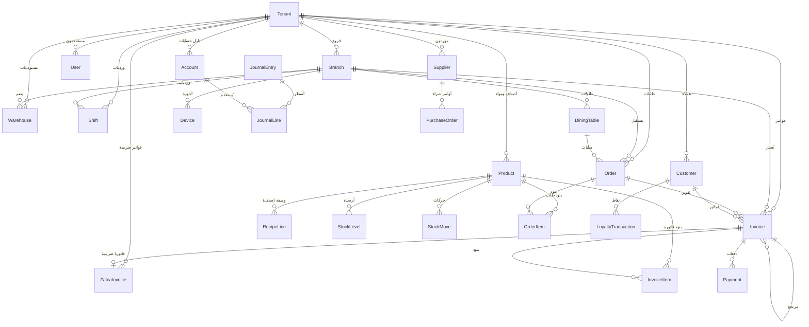
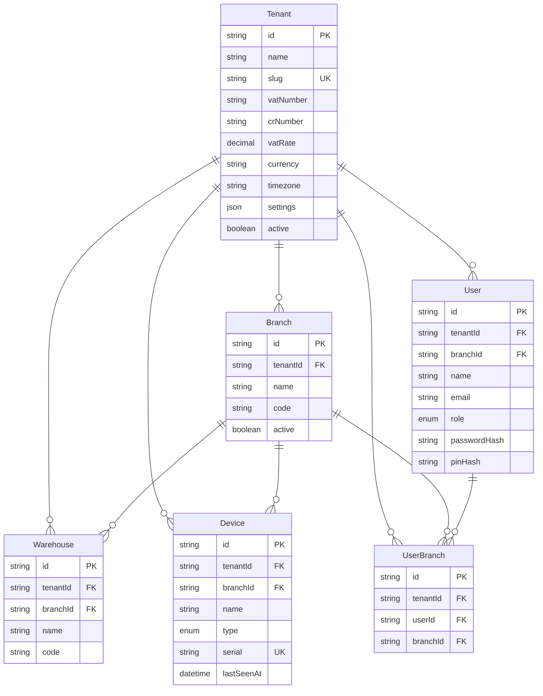
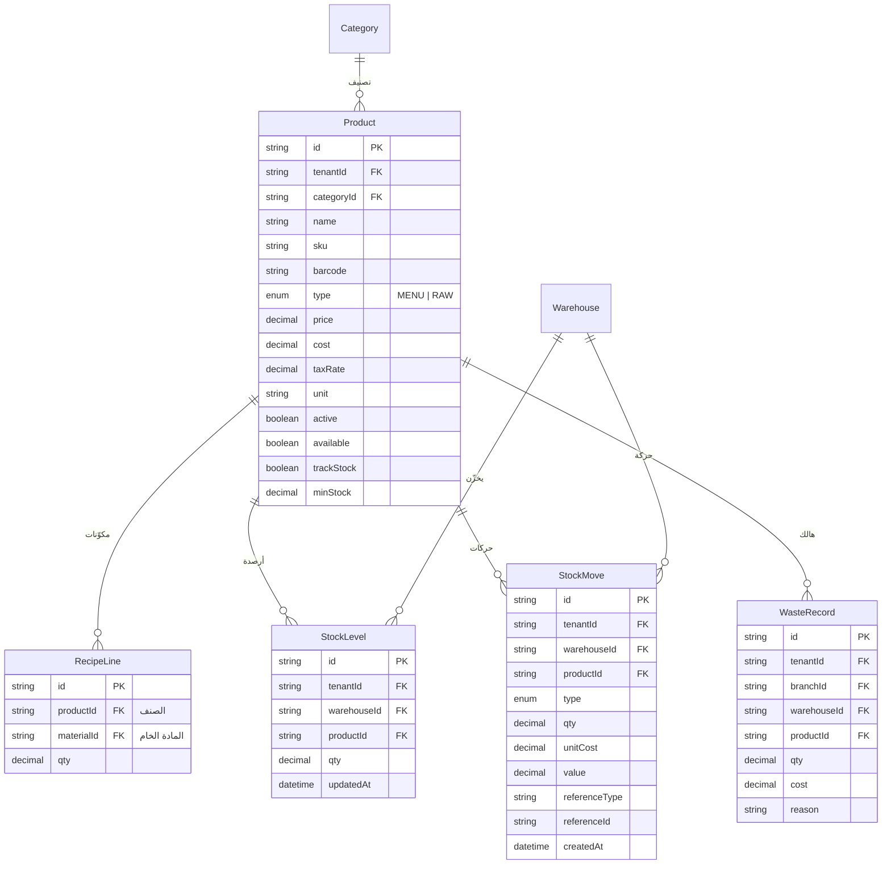
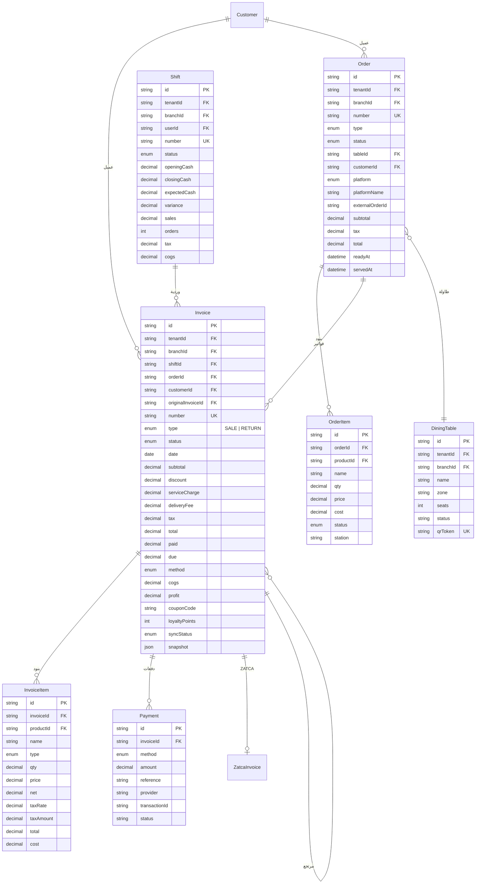
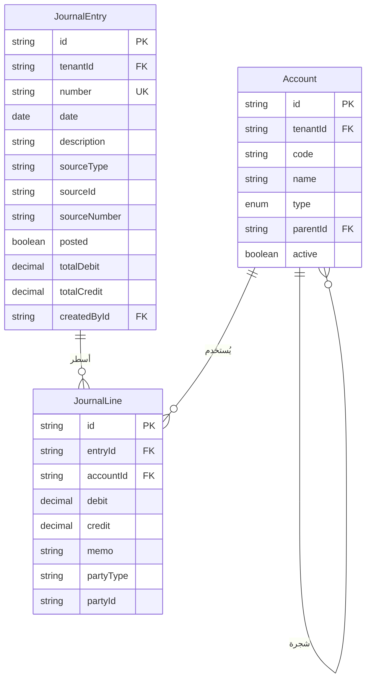
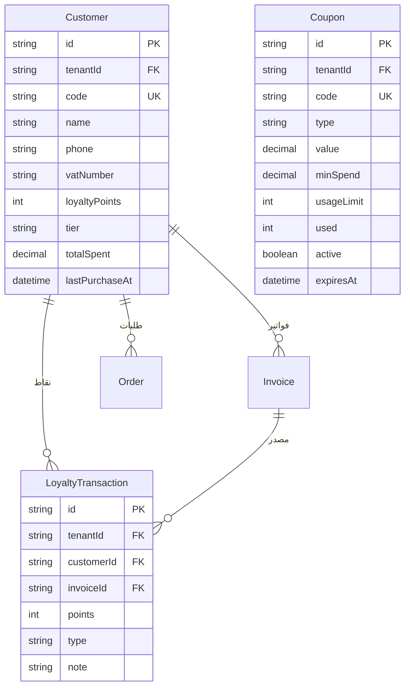
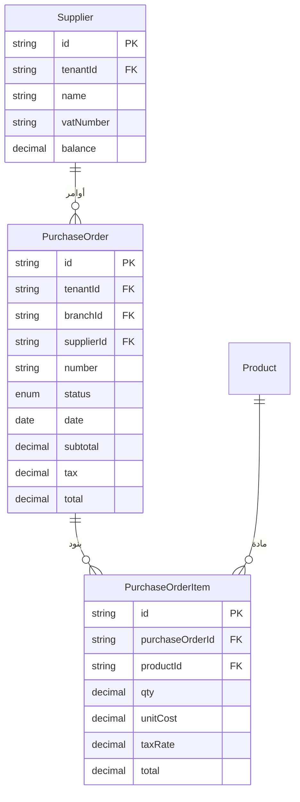
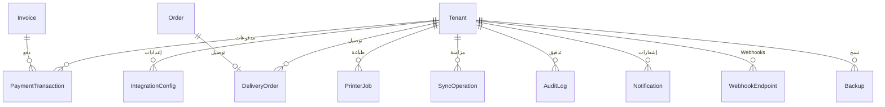
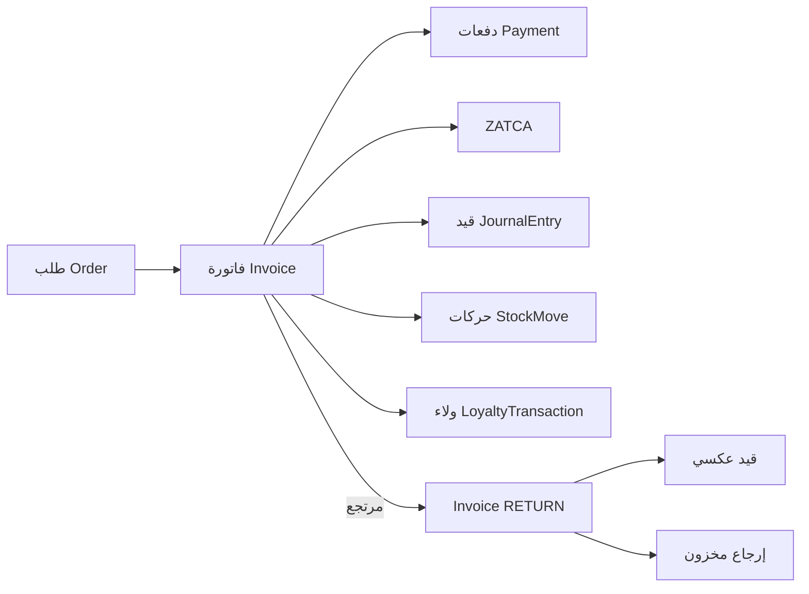

# مخطط الكيانات والعلاقات (ERD) — طلال تكنو

> المصدر الحقيقي: [`packages/database/prisma/schema.prisma`](../packages/database/prisma/schema.prisma)
> PostgreSQL 16 · Prisma 6 · المال `Decimal(12,2)` · الكميات `Decimal(12,3/4)`
> المخطط **مُتحقق منه** بـ`prisma validate`، لكن لم تُنفَّذ ترحيلات على قاعدة فعلية بعد.

## 1. اصطلاحات

| الاصطلاح | المعنى |
|---|---|
| `tenantId` | معرف المستأجر؛ إلزامي في كل جدول أعمال |
| `@db.Decimal(12,2)` | مبلغ مالي بالريال بمنزلتين |
| `@db.Decimal(12,3)` | كمية مخزون بثلاث منازل |
| `@db.Decimal(12,4)` | كمية وصفة BOM بأربع منازل |
| `@db.Date` | تاريخ يومي (بدون وقت) للفواتير والقيود |
| `cuid()` | معرف نصي فريد |
| `onDelete: Cascade` | حذف تابع مع الأب |
| `onDelete: Restrict` | منع الحذف إذا وُجدت مراجع |
| `onDelete: SetNull` | إبقاء السجل وإفراغ المرجع |

## 2. الخريطة العامة



## 3. المؤسسة والهوية



**قيود فريدة مهمة:**

- `Tenant.slug` عالمي.
- `Branch(tenantId, code)`.
- `Warehouse(branchId, code)`.
- `User(tenantId, email)`.
- `Device(tenantId, serial)`.
- `UserBranch(userId, branchId)`.

## 4. الكتالوج والمخزون



**القاعدة:**

- `type = MENU` ← `RecipeLine[]` تشير إلى `type = RAW`.
- توفر الصنف = `min(StockLevel.qty / RecipeLine.qty)` عبر مكوناته المتتبعة.
- `trackStock = false` يستثني المكوّن من حساب التوفر.
- البيع يخصم المواد الخام (وليس الصنف النهائي).
- `StockMove.qty` موجب للدخول وسالب للخروج حسب نوع الحركة.

**أنواع الحركة:** `OPENING`, `PURCHASE`, `SALE`, `SALE_RETURN`, `WASTE`, `ADJUSTMENT`, `TRANSFER_IN`, `TRANSFER_OUT`.

## 5. الطلبات والمبيعات



**ملاحظات:**

- `Order.number` فريد داخل المستأجر.
- `Invoice.number` فريد داخل المستأجر.
- `Invoice.originalInvoiceId` للمرتجعات.
- `Invoice.snapshot` يحفظ بنود/أسعار لحظة البيع (ضروري للفواتير التاريخية).
- `Invoice.syncStatus` لتتبع مزامنة أجهزة POS.
- `Payment.status` نصي (`approved` افتراضياً) لدعم حالات PSP لاحقاً.

## 6. المحاسبة



**القيود:**

- `JournalEntry(tenantId, number)` فريد.
- `JournalLine` لا يحمل `tenantId`؛ العزل عبر `entry.tenantId` و`account.tenantId`.
- `Account(tenantId, code)` فريد.
- لا يمكن حذف حساب مستخدم (`Restrict`).

## 7. ZATCA

```mermaid
erDiagram
    Invoice ||--o| ZatcaInvoice : "1:1"

    ZatcaInvoice {
        string id PK
        string tenantId FK
        string invoiceId FK UK
        string uuid UK
        string type
        string invoiceHash
        string previousHash
        string qr
        string signature
        string xml
        enum status
        string environment
        string warning
        int retries
        datetime issuedAt
        datetime reportedAt
    }
```

**ملاحظات:**

- علاقة 1:1 مع الفاتورة (`invoiceId @unique`).
- `uuid` عالمي فريد.
- `status`: `PENDING | REPORTED | CLEARED | REJECTED` (محلي فقط في Sandbox).
- `environment` يجب أن يكون `sandbox` في هذا الإصدار.
- `previousHash` يبني السلسلة لكل مستأجر.
- `xml` نص كامل للفاتورة UBL.

## 8. CRM والولاء



## 9. المشتريات



**حالات أمر الشراء:** `DRAFT`, `ORDERED`, `RECEIVED`, `CANCELLED` (بحسب enum `PurchaseStatus`).

## 10. التكاملات والمزامنة والتدقيق



| النموذج | الغرض | حقول مفتاحية |
|---|---|---|
| `IntegrationConfig` | إعداد مزود | `kind`, `provider`, `mode`, `enabled`, `config` (بلا أسرار) |
| `PaymentTransaction` | محاولة دفع | `provider`, `amount`, `status`, `reference`, `raw` |
| `DeliveryOrder` | طلب منصة | `platform`, `externalId`, `status`, `payload` |
| `PrinterJob` | مهمة طباعة | `type`, `payload`, `status`, `bytes`, `printer` |
| `SyncOperation` | عملية جهاز | `deviceId`, `entity`, `entityType`, `payload`, `status` |
| `AuditLog` | تدقيق | `userId`, `action`, `entity`, `entityId`, `details`, `ip` |
| `Notification` | إشعار | `channel`, `recipient`, `status`, `payload` |
| `WebhookEndpoint` | Webhook صادر | `url`, `secretHash`, `events`, `active` |
| `Backup` | نسخة | `path`, `size`, `checksum`, `encrypted`, `createdAt` |

> **تنبيه:** لا تُخزَّن مفاتيح المزودين في `IntegrationConfig.config`؛ القيم الحساسة تُقرأ من متغيرات البيئة فقط. الحقل مخصص لمعرّفات غير سرية وإعدادات عرض.

## 11. العلاقات الحاكمة (Rules)

1. **كل جدول أعمال له مسار مستأجر:** إما `tenantId` مباشر، أو عبر أب (`InvoiceItem → Invoice → tenantId`).
2. **المراجع المالية لا تُحذف:** `Restrict` على الحسابات والموظفين المرتبطين بورديات، و`SetNull` للمراجع الاختيارية.
3. **الفواتير تاريخية:** لا تُحدَّث بنودها بعد الإصدار؛ التصحيح عبر مرتجع أو قيد عكسي.
4. **الطلبات قابلة للتعديل:** يمكن إضافة بنود/تغيير حالة قبل الفوترة.
5. **الوردية لا تُحذف:** تُغلق فقط.
6. **ZATCA سجل دائم:** لا يُحذف إلا بحذف الفاتورة (Cascade) — ممنوع عملياً.
7. **المخزون لا يُحذف:** تُسجَّل الحركات؛ التسوية تعدّل الرصيد عبر حركة.
8. **العملاء/الموردون:** `SetNull` على الفواتير للحفاظ على السجل المالي.

## 12. الفهارس وسببها

| الفهرس | الاستخدام |
|---|---|
| `Invoice(tenantId, date)` | تقارير الفترة |
| `Invoice(tenantId, type, status)` | المرتجعات والمتأخرات |
| `Order(tenantId, status, createdAt)` | طابور KDS |
| `Order(platform, externalOrderId)` | منع تكرار طلبات التوصيل |
| `StockMove(tenantId, createdAt)` | حركة المخزون |
| `StockLevel(warehouseId, productId)` فريد | رصيد واحد لكل مستودع/مادة |
| `JournalEntry(tenantId, date)` | ميزان المراجعة |
| `ZatcaInvoice(tenantId, issuedAt)` | سلسلة التجزئة |
| `SyncOperation(deviceId, status)` | متابعة الأجهزة |
| `AuditLog(tenantId, createdAt)` | التحقيق |

## 13. دورة حياة البيانات



- لا حذف للفواتير المفوترة؛ تُلغى بمرتجع.
- إلغاء طلب قبل الفوترة: `status = CANCELLED` مع الاحتفاظ بالسجل.
- حذف مستأجر (Cascade) عملية إدارية خطرة تتطلب نسخة احتياطية.

## 14. ما لم يُنمذج بعد

- جداول HR/رواتب/بصمات (مذكورة كوحدة لكنها غير منفذة في المخطط).
- تعدد العملات وأسعار الصرف.
- الضرائب المتعددة/الإعفاءات.
- إدارة العروض/الوجبات المركبة (Combo) ككيانات مستقلة.
- تخصيص المخزون (Reservations) لأصناف معينة.
- سجل تغييرات تفصيلي لكل حقل (CDC).

هذه فجوات معروفة في ROADMAP وليست أخطاء في المخطط الحالي؛ تُضاف عند الحاجة إليها في P5.
